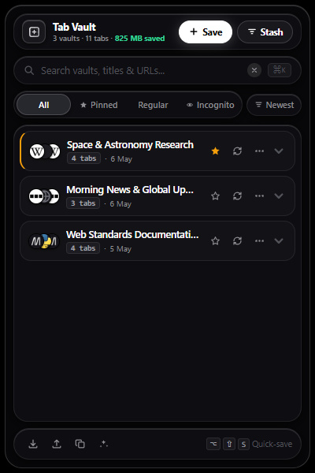
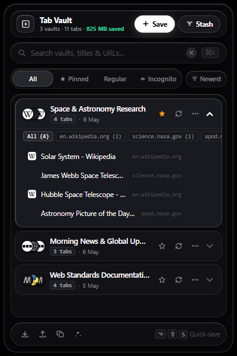

I built Tab Vault for my own use as a personal browser extension.

## What it does

Tab Vault is a Chrome extension that saves the open tabs in your current browser window into a saved session ("vault") stored locally on your device. You can name, search, organize, and restore those tabs later in a new window, in your current window, or in an incognito window.

## How to install

1. Clone or download this repository to your computer.
2. Open your Chromium-based browser (such as Google Chrome or Brave) and navigate to `chrome://extensions`.
3. Enable "Developer mode" using the toggle in the upper-right corner.
4. Click "Load unpacked" in the upper-left corner.
5. Select the folder containing this repository (the folder containing `manifest.json`).
6. Optional: To allow Tab Vault to save or restore tabs in private browsing, open Tab Vault's extension details page in `chrome://extensions` and enable "Allow in Incognito".

## Keyboard shortcuts

- `Alt+Shift+S` (or `Option+Shift+S` on macOS): Quick-save all open tabs in the active window without opening the popup.
- `Ctrl+K` or `Cmd+K` or `/`: Focus the search input when the popup is open.
- `Escape`: Clear search input or dismiss open menus in the popup.

You can customize the quick-save shortcut at any time by navigating to `chrome://extensions/shortcuts`.

## Features

- Save window: Saves all open tabs in the current window into a session.
- Stash window: Saves all open tabs in the current window, opens a blank new tab, and closes the saved tabs.
- Tab restoration: Reopen a saved session in a new window, in the current window, or in an incognito window.
- Search: Filter saved sessions by session name, tab title, or tab URL.
- Filtering: View all sessions, or filter by pinned, regular, or incognito sessions.
- Sorting: Order sessions by newest first, total tab count, or alphabetical name.
- Pin sessions: Pin important sessions so they stay at the top of the list.
- Tab inspection: Expand any session to inspect individual tab titles, URLs, and site icons.
- Domain filtering: Filter tabs within an expanded session by domain.
- Tab management: Remove individual tabs from a session, or copy an individual tab URL to the clipboard.
- Session editing: Rename a session or merge currently open tabs into an existing session.
- Deduplication: Remove duplicate tab URLs within a specific session, or across all saved sessions.
- Markdown export: Copy tab links for a session or for all sessions as Markdown lists.
- Backup and restore: Export a single session or all sessions as JSON files, and import sessions from JSON files.
- Undo deletion: Five-second undo prompt after deleting a session.

## Privacy behaviour

Tab Vault is designed with local-first storage, but you should be aware of the following behaviours:

- Local storage: Tab Vault stores tab titles and URLs in the browser's local extension storage (`chrome.storage.local`) on your device.
- Incognito privacy: If you use the extension in an incognito window, the titles and URLs of your incognito tabs are written to the browser's persistent local extension storage on disk. This weakens incognito privacy because those browsing records persist after the incognito window is closed.
- No remote telemetry: Tab Vault does not transmit your tab lists, URLs, or sessions to any server or remote service.
- Favicon lookups: When displaying site icons in the popup interface, Tab Vault uses the icon URL provided by the browser if available. These icons are loaded from the websites themselves each time the popup opens. If that icon URL is missing or points to a browser internal scheme, Tab Vault requests the icon from Google's public favicon service (`https://www.google.com/s2/favicons?domain=...`). This request transmits the domain name (not the full URL path) to Google servers, which reveals to Google which website domains you have saved.

## Limitations

- Personal tool: This extension was built for personal use and has not been tested across every browser, browser version, or operating system.
- Vault size and storage limits: Storage quota limits are not handled in code. Tab Vault relies on standard `chrome.storage.local` without the `unlimitedStorage` permission. If you save thousands of tabs or very large sessions, you may reach the browser's storage quota limit.
- Session state: Restoring tabs reopens the saved URLs; it does not restore form inputs, scroll position, navigation history, or session cookies.
- Memory estimates: The RAM saved figure shown in the interface is an informal heuristic estimate (calculated as 75 MB per tab) rather than a measurement of actual system memory freed.
